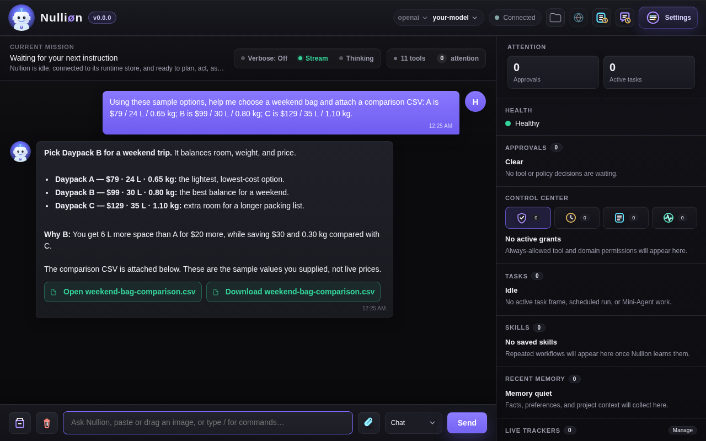

<div align="center">
  
  <h1>Nulliøn</h1>
  <p><strong>Hand off the work. Keep the controls.</strong></p>
  <p>Your personal AI assistant for browser research, useful files, and work that keeps running after you ask.</p>
  <p>
    <a href="#get-started"><strong>Get started</strong></a> ·
    <a href="https://www.nullion.ai/#demo">Watch the demo</a> ·
    <a href="docs/README.md">Read the docs</a> ·
    <a href="https://github.com/shumanhi/nullion/releases">Latest release</a>
  </p>
  <p>Open source · Runs on your computer · Bring your own model · macOS, Windows &amp; Linux</p>
</div>

Nullion connects the model you choose to your browser, files, and enabled tools.
Ask from the local Web console, Telegram, Slack, or Discord. Get an answer, a
file you can use, or an update when a scheduled job or temporary watch has news.
You choose the capabilities, connected accounts, and approval rules.

## What would you hand off?

| You ask | Nullion can help you get |
| --- | --- |
| “Compare these three options, explain the tradeoffs, and attach a PDF.” | A comparison with findings, sources, and a downloadable report. |
| “Turn these attached notes into a project brief.” | A useful document built from the material you supplied. |
| “Every weekday at 8 AM, send me a briefing on these topics.” | Recurring research delivered to the chat you selected. |
| “Watch this page for two hours. Tell me once tickets become available.” | A temporary, read-only tracker with a defined end time. |
| “What did we decide about this earlier?” | Relevant saved conversation history and memory, when available. |

Capabilities depend on the tools and providers you enable. Websites can restrict
access, and account integrations need their own setup and permission.

<!-- This is the real Web UI with explicitly labeled example data, not a live customer workspace. -->


*The actual Web console with sample data. [Watch the product demo](https://www.nullion.ai/#demo).*

## Why Nullion?

**Your assistant, wherever you chat.** Start in the Web console or connect
Telegram, Slack, or Discord. Conversation context, tools, approvals, and results
use the same shared assistant underneath.

**Work you can see.** Follow planned tasks and current activity, review requests
for permission, and receive a clear final result. Planner cards and detailed
activity have separate controls, so you can choose how much to see.

**Useful beyond the current message.** Set reminders and recurring jobs, or
watch a condition for a limited time. Keep your hosting machine running and
connected for background work and notifications.

**A setup you control.** Choose your model provider, enabled tools, file roots,
browser, and connected accounts. Repeated workflows can become reusable skills
through reviewable proposals.

## Get started

### 1. Install

**macOS or Linux** — open Terminal:

```bash
curl -fsSL "https://raw.githubusercontent.com/shumanhi/nullion/main/install.sh?$(date +%s)" | bash
```

**Windows** — open PowerShell:

```powershell
irm https://raw.githubusercontent.com/shumanhi/nullion/main/install.ps1 | iex
```

You can inspect the [macOS/Linux installer](install.sh) or
[Windows installer](install.ps1) before running it. Already cloned the repo?
Run `bash install.sh` on macOS or Linux.

The installer supports Python **3.11–3.13** and attempts to install a compatible
version when needed. It prepares the browser worker and guides you through
configuration. Initial downloads and optional capabilities can take several
minutes. If a dependency cannot be installed automatically, follow the setup
instructions and rerun the installer.

### 2. Connect your model and tools

Open the console at **[localhost:8742](http://localhost:8742)**, or run:

```bash
nullion --dashboard
```

Choose your provider and model in **Settings → Model**. Enable the browser and
file capabilities you want to use; connect chat apps or accounts when you need
them. The local Web console works without a Telegram account.

See [Configuration](docs/configuration.md), [Plugins and account connections](docs/plugins.md),
and [Chat setup](docs/configuration.md#chat-adapters).

### 3. Give it a first task

With browser access enabled, try:

> Open https://example.com in the browser and summarize what the page says.

Then try a file task:

> Create a weekend-trip packing checklist and attach it as a PDF.

If a capability needs an optional package or additional setup, complete its
reviewable setup request first. Start with a small task and narrowly scoped
permissions, then add the tools you want to trust.

## Local first, with clear boundaries

- **Local state.** History, memory, schedules, skills, and runtime state are
  stored on the machine running Nullion. Your selected model and connected
  services receive the data needed for the work you authorize; local storage
  does not make cloud processing local.
- **Explicit access.** Tool permissions are separate from allowed files,
  destinations, and accounts. Sensitive actions can pause for your approval;
  you can inspect and revoke grants. Review the approval mode you select.
- **Workspace ownership.** Member workspaces keep their own context and account
  connections. Access to one workspace does not automatically grant another
  member access to your accounts.
- **Honest costs.** Nullion is open-source software under Apache 2.0. Model
  providers, APIs, and other connected services may charge for usage.

Chat history and saved provider credentials support local encryption, including
optional operating-system key storage. This is **not encryption of every file**
in the instance directory: generated files, logs, runtime records, and browser
profiles can contain private data. Read [Security and data handling](SECURITY.md)
before connecting sensitive accounts.

## Make it yours

| Explore | Start here |
| --- | --- |
| Browser research and visible browser setup | [Browser guide](src/nullion/plugins/browser_plugin/README.md) |
| Reminders, recurring jobs, and temporary watches | [Live tracking and scheduled work](docs/live-tracking.md) |
| Search, files, media, and account connections | [Plugin catalog](docs/plugins.md) |
| Reusable instructions and optional skill packs | [Skill packs](docs/skill-packs.md) |
| Models, chat apps, storage, and settings | [Configuration](docs/configuration.md) |
| Everyday chat and terminal commands | [Command reference](docs/commands.md) |

Email and calendar integrations are **preview features** with provider-specific
setup. Connecting Telegram, Slack, or Discord as a chat interface does not
itself grant account-level messaging access.

## Updates and help

Update an installed copy to the latest release:

```bash
nullion update
```

Useful commands when you need a closer look:

```bash
nullion --status
nullion --logs
nullion --restart
```

[Find setup and troubleshooting help](docs/support.md) or
[report a bug](https://github.com/shumanhi/nullion/issues).
Include your OS, version, and reproduction steps; keep credentials and private
data out of public reports.

<details>
<summary>Uninstall or recover an installation</summary>

```bash
nullion uninstall --dry-run
nullion uninstall --keep-data
```

Remove the install and its data with `nullion uninstall`. Use `--dry-run` to
preview removal or `--keep-data` to retain local data.

If the main app cannot start, `nullion-recovery status` provides a separate
recovery entry point. For a broken Windows update, see
[Windows installation repair](docs/support.md#updates-and-rollback).

</details>

## Build with us

Nullion is open source. Contributions to browser reliability, integrations,
accessibility, documentation, and everyday workflows are welcome.

The runtime uses LangGraph, LangChain-compatible adapters, and Deep Agents.
Client adapters share one execution pipeline and presentation contract.
See [Architecture](docs/architecture.md) for how it fits together and
[Contributing](docs/e2e-testing.md) to work on the project.

Licensed under [Apache 2.0](LICENSE). Please report vulnerabilities privately
through [GitHub Security Advisories](https://github.com/shumanhi/nullion/security/advisories/new),
following the [security policy](SECURITY.md).
